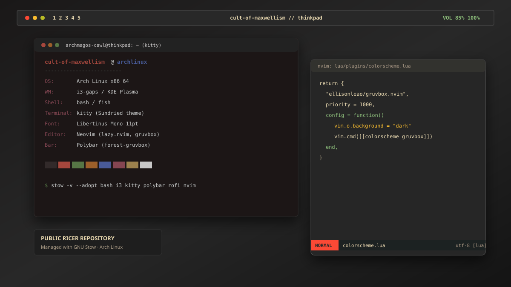

# ◈ cult-of-maxwellism // dotfiles

<p align="center">
  
</p>

<p align="center">
  <a href="https://archlinux.org/"></a>
  <a href="https://www.gnu.org/software/stow/"></a>
  <a href="https://i3wm.org/"></a>
  <a href="https://neovim.io/"></a>
  <a href="LICENSE"></a>
</p>

---

## Overview

A curated, Git-backed and [GNU Stow](https://www.gnu.org/software/stow/)-managed repository of personal Linux configurations, aesthetic customizations, and desktop ricing assets. Designed for rapid deployment, modular package management, and zero-headache recovery.

> **Current Workflow Stage:** Dual-session daily driver (KDE Plasma Wayland + i3-gaps X11 fallback), stepping towards an automated Hyprland workstation with rapid theme-switching capabilities.

---

## 🛠 Tech Stack & Aesthetics

| Component | Software / Configuration | Details |
|---|---|---|
| **OS** | [Arch Linux](https://archlinux.org/) | Rolling release |
| **Window Managers** | [i3-gaps](https://i3wm.org/) / [KDE Plasma](https://kde.org/plasma-desktop/) | Dual X11/Wayland environment |
| **Bar** | [Polybar](https://github.com/polybar/polybar) | Customized Gruvbox `forest` theme + custom modules |
| **Terminal** | [Kitty](https://sw.kovidgoyal.net/kitty/) | `Sundried` colorway, GPU accelerated |
| **Shells** | [Bash](https://www.gnu.org/software/bash/) & [Fish](https://fishshell.com/) | Interactive prompt + POSIX login scripts |
| **App Launcher** | [Rofi](https://github.com/davatorium/rofi) | Gruvbox sidebar style |
| **Editor** | [Neovim](https://neovim.io/) | Lua config powered by `lazy.nvim`, Treesitter, Telescope |
| **Typography** | [Libertinus Mono](https://github.com/alerque/libertinus) & Serif Display | Editorial serif & distinct monospace typesetting |
| **GTK / Qt Themes** | Breeze-Dark & [kvantum-dark](https://github.com/tsujan/Kvantum) | Unified dark toolkit styles |
| **Cursor Theme** | [WhiteSur-cursors](https://github.com/vinceliuice/WhiteSur-cursors) | Smooth 24–48px dark pointers |
| **Wallpaper** | ThinkPad schematic artwork | Managed via `feh` |

---

## 📁 Repository Structure

Each directory functions as an independent **GNU Stow package** that mirrors the user's `$HOME`:

```text
~/.config/dotfiles/
├── assets/             # Screenshots and preview media
├── bash/               # ~/.bashrc, ~/.bash_profile, ~/.bash_logout
├── fish/               # ~/.config/fish/config.fish, fish_variables
├── gtk/                # GTK 3.0, GTK 4.0, xsettingsd, legacy .gtkrc
├── i3/                 # ~/.config/i3/config (inner/outer gaps, shortcuts)
├── kde-theme/          # ~/.config/kdeglobals, kwinrc, plasmarc
├── kitty/              # ~/.config/kitty/kitty.conf, current-theme.conf
├── neofetch/           # ~/.config/neofetch/config.conf
├── nvim/               # ~/.config/nvim/ (init.lua, lazy-lock, plugins)
├── polybar/            # ~/.config/polybar/ (launch.sh, forest Gruvbox theme)
├── qt/                 # ~/.config/qt6ct/qt6ct.conf
├── rofi/               # ~/.config/rofi/config.rasi
├── x11/                # ~/.Xresources, ~/.xprofile, ~/.fehbg
├── .gitignore
├── LICENSE
└── README.md
```

---

## 🚀 Installation & Stow Deployment

### 1. Clone the repository

```bash
git clone git@github.com:cult-of-maxwellism/dotfiles.git ~/.config/dotfiles
cd ~/.config/dotfiles
```

### 2. Deploy all packages

To link every configuration to `$HOME`:

```bash
stow -v -t ~ bash fish gtk i3 kde-theme kitty neofetch nvim polybar qt rofi x11
```

Or deploy individual components on demand:

```bash
stow -v -t ~ kitty nvim   # Only terminal and editor
stow -v -t ~ i3 polybar   # Only window manager and status bar
```

### 3. Restowing & Rolling Back (Quick Recovery)

If you modify configurations or need to re-synchronize links:

```bash
# Refresh / re-link packages
stow -R -v -t ~ <package-name>

# Unlink a package safely
stow -D -v -t ~ <package-name>
```

---

## 📦 Recommended System Packages

### Arch Linux (pacman & yay)

```bash
# Core desktop & ricing utilities
sudo pacman -S --needed \
    i3-gaps polybar rofi kitty neofetch feh xss-lock \
    brightnessctl network-manager-applet pavucontrol pulseaudio-utils \
    stow git rsync fish

# Editor & Development
sudo pacman -S --needed neovim ripgrep fd fzf

# Fonts & Appearance
sudo pacman -S --needed \
    ttf-libertinus ttf-nerd-fonts-symbols-common \
    qt6ct kvantum breeze-gtk
```

---

## 🎨 Color Palette & Theming Reference

- **Terminal (Kitty Sundried):**
  - Background: `#1a1818` | Foreground: `#c8c8c8`
  - Accent / Red: `#a6463d` | Green: `#577644` | Blue: `#485a98`
- **Polybar (Forest Gruvbox):**
  - Background: `#282828` | Foreground: `#ebdbb2`
  - Accent Red: `#fb4934` | Aqua: `#8ec07c` | Dark Accent: `#313131`

---

## 📄 License

This repository is licensed under the [MIT License](LICENSE).
Feel free to fork, adapt, and rice!
